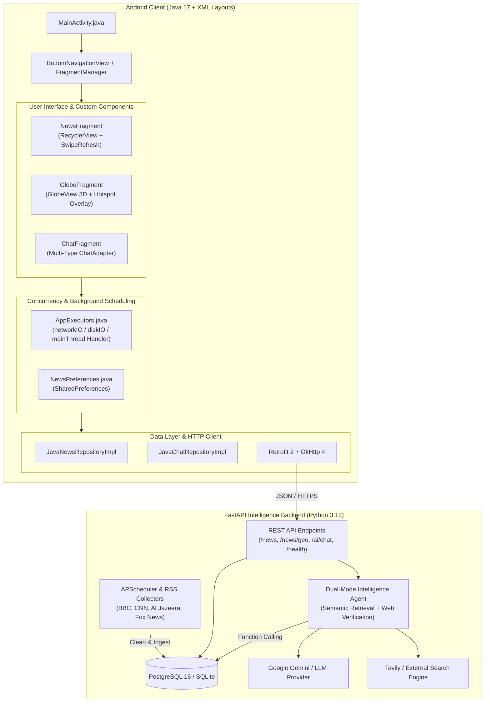

# GlobalNewsAI

> **Full-Stack Global Situational Intelligence & Real-Time News Analysis Platform**

[](app/)
[](backend/)
[](backend/)
[](LICENSE)

GlobalNewsAI is a comprehensive, production-ready situational awareness and global news intelligence application. It seamlessly unites an **Android native client** (pure Java 17 + classic XML layout system) with a **high-throughput intelligence backend** (FastAPI, PostgreSQL, asynchronous RSS ingestion, and a Dual-Mode AI Agent).

---

## Key Capabilities & Highlights

### 1. Multi-Source News Feed (`NewsFragment`)
- **Authoritative Aggregation**: Automatically monitors and synchronizes RSS feeds from globally recognized outlets (BBC News, CNN, Al Jazeera, Fox News).
- **Strict Copyright Compliance**: Stores only essential metadata, category tags, timestamps, and normalized URLs. Reading the full article triggers an implicit Android `Intent.ACTION_VIEW` directly to the original publisher's website.
- **Categorization & Pagination**: Supports filtering by category (`WORLD`, `TECH`, `BUSINESS`, `SCIENCE`, `HEALTH`), swipe-to-refresh (`SwipeRefreshLayout`), and smooth end-of-list pagination.
- **Offline Preferences**: Encapsulates user preferences (e.g., default topic category, theme settings) via `SharedPreferences`, restoring user state on cold starts.

### 2. 3D Tactical Situational Globe (`GlobeView`)
- **Native 2D Canvas 3D Rendering**: Engineered as a custom Android `View` (`GlobeView.java`) with mathematical 3D spherical coordinate projection, yaw/pitch matrix transformation, and front-hemisphere occlusion culling ($Z > 0$).
- **Natural Earth 110m Vector Geography**: Accurately renders real continental landmasses, coastlines, and sovereign country borders directly from vector datasets.
- **Tactical Visual Language**: Features Rayleigh scattering atmospheric outer glow, oceanic specular gradient lighting, coordinate graticules (parallels & meridians), and global strategic intelligence connection arcs.
- **Multi-Touch Gestures**: Seamlessly handles single-finger drag to rotate (with pitch bounds $[-80^\circ, +80^\circ]$) and two-finger pinch-to-zoom ($0.7\times - 2.4\times$) via `ScaleGestureDetector`, with touch-intercept delegation to prevent scrolling conflicts.
- **Spatial Hotspot Clustering**: Aggregates dense geographic hotspots dynamically based on screen-space Euclidean distance thresholding. Pulsating radar rings distinguish intelligence categories:
  - **Politics**: Orange (`#F97316`)
  - **Economy / Business**: Emerald (`#10B981`)
  - **Technology**: Cyan (`#06B6D4`)
  - **Military**: Crimson (`#EF4444`)
  - **Disaster / Health**: Amber (`#F59E0B`)
- **Two-Way View Synchronization**: Tapping a news card in the feed automatically triggers a smooth camera tween animation (`rotateToLocation`) focusing on that city's coordinates; tapping a globe marker pops up a tactical card overlay displaying coordinates (e.g., `Kyiv, Ukraine (50.5°, 30.5°)`).

### 3. Dual-Mode AI Intelligence Agent (`ChatFragment`)
- **Multi-Type Message Stream**: Powered by a custom `RecyclerView` adapter (`ChatAdapter.java`) differentiating user query bubbles, AI assistant responses, animated thinking states, and dynamic verification source cards with `DiffUtil`.
- **Mode 1 — Title Search & Semantic Retrieval**: Parses natural language constraints (e.g., *"What happened in the technology sector today?"*) and queries local database records using function calling, ensuring grounded sources and preventing hallucination.
- **Mode 2 — Real-Time Web Verification**: Cross-verifies claims, breaking alerts, or quotes across multiple independent search engines, citing source media links.
- **Hardened Security**: Features automated heuristic sanitization to defend against Prompt Injection and jailbreak payloads (e.g., `IGNORE PREVIOUS INSTRUCTIONS`, `DAN`).

### 4. Concurrency & Clean Architecture
- **Thread Safety**: Completely decouples background operations using `AppExecutors.java` (a 4-thread pool for `networkIO`, a single-thread executor for `diskIO`, and a dedicated main-thread `Handler` bound to `Looper.getMainLooper()`).
- **Standard MVVM / Repository Architecture**: Decouples UI controllers from data layers through contract interfaces (`JavaNewsRepository`, `JavaChatRepository`).

---

## System Architecture



---

## Directory Structure

```
GlobalNewsAI/
├── app/                              # Android Native Client
│   ├── src/main/java/com/example/newsagnet/
│   │   ├── MainActivity.java         # Root Activity & navigation hosting
│   │   ├── concurrency/              # AppExecutors & ResultCallback
│   │   ├── data/prefs/               # SharedPreferences persistence
│   │   ├── model/                    # JavaBean domain entities (NewsArticle, ChatMessage)
│   │   ├── network/                  # Retrofit 2 API services & DTOs
│   │   ├── repository/               # Java Repository contracts & implementations
│   │   └── ui/
│   │       ├── adapter/              # RecyclerView Adapters & ViewHolders
│   │       ├── fragment/             # NewsFragment, GlobeFragment, ChatFragment
│   │       └── globe/                # GlobeView (3D Canvas), GlobeMath, WorldMapLoader
│   └── src/main/res/                 # XML layouts, drawables, colors, styles
├── backend/                          # FastAPI Intelligence Backend
│   ├── app/
│   │   ├── api/                      # REST routers (news, chat, health)
│   │   ├── collectors/               # Multi-source RSS ingestion workers
│   │   ├── db/                       # SQLAlchemy models, sessions & Alembic migrations
│   │   ├── models/                   # Pydantic schemas & DTOs
│   │   ├── repositories/             # Database access layers
│   │   └── services/                 # LLM Agent, Dual-Mode Dispatcher & Web Search
│   └── tests/                        # Pytest automated test suite (49 test cases)
├── docker-compose.yml                # Production multi-container orchestration
├── build.gradle.kts                  # Root Gradle build script
└── README.md                         # Project documentation
```

---

## Quick Start

### Option 1: Docker Compose (Recommended for Full Stack)

To deploy both the PostgreSQL database and the FastAPI service with a single command:

```bash
# 1. Clone repository
git clone https://github.com/<your-username>/GlobalNewsAI.git
cd GlobalNewsAI

# 2. Configure environment variables (optional: add LLM API keys)
cp .env.example .env

# 3. Build and launch services
docker compose up --build -d
```

The backend services will be available at:
- **Interactive API Documentation (Swagger UI)**: [http://localhost:8000/docs](http://localhost:8000/docs)
- **Health Check Probe**: [http://localhost:8000/health](http://localhost:8000/health)
- **Geographic News GeoJSON**: [http://localhost:8000/api/v1/news/geo](http://localhost:8000/api/v1/news/geo)

---

### Option 2: Local Development Setup

#### 1. Backend Service
```bash
cd backend
python3 -m venv .venv
source .venv/bin/activate
pip install -r requirements.txt

# Start local server with hot-reload
uvicorn app.main:app --host 0.0.0.0 --port 8000 --reload
```

#### 2. Android Client
Open the project root in **Android Studio** (Koala or newer) or build from the command line:

```bash
# Run all unit tests
./gradlew testDebugUnitTest

# Build Debug APK
./gradlew assembleDebug
# Generated output: app/build/outputs/apk/debug/app-debug.apk

# Build R8-optimized Release APK
./gradlew assembleRelease
# Generated output: app/build/outputs/apk/release/app-release-unsigned.apk
```

> **Note on Emulator Networking**: The Android client is configured to connect to `http://10.0.2.2:8000/api/v1/`, which maps directly to `localhost:8000` on your development host.

---

## Testing & Quality Assurance

GlobalNewsAI maintains comprehensive test suites across both the Android client and the Python backend:

```bash
# 1. Android Unit Tests (66 test cases covering OOP models, Adapters, AppExecutors, GlobeMath)
./gradlew testDebugUnitTest

# 2. Android Lint Static Analysis (0 Errors, 0 Warnings)
./gradlew lintDebug

# 3. Python Backend Automated Tests (49 test cases covering API, Agent, RSS, GeoJSON)
PYTHONPATH=backend backend/.venv/bin/pytest backend/tests -v

# 4. Code Formatting & Linting (Python Ruff)
backend/.venv/bin/ruff check backend
```

---

## License & Attribution

- **License**: Released under the [Apache 2.0 License](LICENSE).
- **Map Data**: Vector geography derived from [Natural Earth](https://www.naturalearthdata.com/) (Public Domain).
- **News Sources**: News headlines and summaries are fetched via publicly syndicated RSS feeds for informational purposes. All rights and trademarks belong to their respective publishers (BBC, CNN, Al Jazeera, Fox News).
